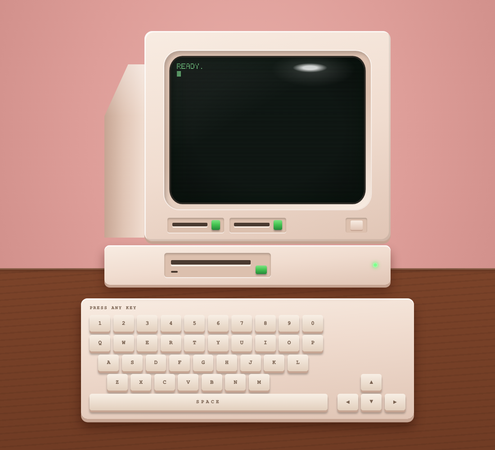

# Build a retro game

Make your own retro arcade game in 30 minutes with [Factory](https://factory.ai). No coding experience needed.

You start with an old-school computer that's switched on and says `READY.`, with nothing inside it. You describe the game you want. Droid plans it with you, builds it, tests it, and packs it into one file you can send to anyone.

<p align="center"></p>

Built for the Women in AI workshop (Factory, Sapienne, and Sequoia, October 27, 2026). Setup page: **https://factory-ashley-jepson.github.io/retro-game/**

## Setup (5 minutes)

1. **Download the Factory app** and sign in: [Mac (Apple chip)](https://app.factory.ai/api/desktop?platform=darwin&architecture=arm64), [Mac (Intel)](https://app.factory.ai/api/desktop?platform=darwin&architecture=x64), [Windows](https://app.factory.ai/api/desktop?platform=win32&architecture=x64), [Windows (ARM)](https://app.factory.ai/api/desktop?platform=win32&architecture=arm64).
2. **Install the kit.** Start a new session and paste:

   ```text
   Install the retro game workshop kit for me. Download https://github.com/factory-ashley-jepson/retro-game/archive/refs/heads/main.zip to a temporary folder and unzip it. Copy the game folder inside retro-game-main to a new folder named my-game in my home folder: ~/my-game on Mac, or %USERPROFILE%\my-game on Windows. If my-game already exists, ask me before changing it. Then copy the four skill folders inside retro-game-main/.factory/skills (plan-game, build-game, playtest, ship-game) into my personal skills folder: ~/.factory/skills on Mac, or %USERPROFILE%\.factory\skills on Windows. Create any folders that are missing, and don't change anything else. Open my-game/index.html in my browser so I can see the empty computer, then tell me to start a new session and type /plan-game.
   ```

## Build it like a real team

Start a new session and go through the same loop software teams use.

| Step | Type | What happens |
| ---- | ---- | ------------ |
| **1. Plan** | `/plan-game` | Droid asks what kind of game, who the hero is, how you win, and the vibe. You name it. Droid writes the plan to `SPEC.md`. |
| **2. Build** | `/build-game` | Droid builds the plan one piece at a time and shows you the game after each piece. |
| **3. Test** | `/playtest` | Droid plays the game and checks every item in the plan, with pass or fail and proof. |
| **4. Ship** | `/ship-game` | Droid packs the game into one file you can email, AirDrop, or Slack to anyone. |

Then go around again: pick a stretch goal from your plan, build it, test it, ship version 2.

## Ideas

- **Inbox Zero:** an AI agent jumps over emails that keep coming faster.
- **Term Sheet Dodge:** a founder dodges bad term sheets and catches good ones.
- **Star Cat:** a cat floats through space collecting stars.
- **Pollen Run:** a bee flies through gaps between flowers.

Small asks work best: "add a coffee power-up that makes me faster for 3 seconds" beats "make it better".

## What's in the box

| Path | What it is |
| ---- | ---------- |
| `game/` | The empty computer. It's copied to `~/my-game` on your computer. |
| `game/game.js` | Your game. It starts nearly empty: a `READY.` screen. |
| `game/sprites.js` | Your pixel art. Each sprite is rows of letters, and each letter is a color. |
| `game/engine.js` | Helpers for drawing, text, keys, sound, and the game loop. |
| `game/index.html`, `game/style.css` | The retro computer around the screen, with a keyboard that lights up as you type. |
| `game/SPEC.md` | Your game's plan, filled in by `/plan-game`. |
| `.factory/skills/` | The four workshop skills: `plan-game`, `build-game`, `playtest`, `ship-game`. |
| `docs/` | The setup page, served on GitHub Pages. |
| `workshop/` | Facilitator notes: run of show, helper card, and the pre-event email. |

## Credits

The retro computer and engine come from [Big Game Run](https://github.com/factory-ashley-jepson/stanford-tree-game). MIT licensed. See `LICENSE`.
